<!-- header:start -->
<div align="center">



<a href="#-quick-start"></a>

<a href="LICENSE"></a>

<a href="https://github.com/ajendras/skillora/stargazers"></a>
<a href="https://github.com/ajendras/skillora/actions/workflows/ci.yml"></a>

<a href="CONTRIBUTING.md"></a>

**Scaffolds, validates, tests and benchmarks reusable skills for LLM agents with zero boilerplate.**

[✨ Features](#-features) • [⚡ Quick start](#-quick-start) • [🧰 Usage](#-usage) • [🧩 Architecture](#-architecture) • [📍 Roadmap](#-roadmap) • [🤝 Contributing](#-contributing)

</div>
<!-- header:end -->

## ✨ Why Skillora?

AI agents are only as good as the skills they use, yet creating, validating, testing and benchmarking each skill is repetitive busywork with no standard interface. Skillora closes the gap with a strict but lightweight framework that generates tests, docs, benchmarks and a portable manifest from a single implementation.

- **Scaffold instantly** — `skillora new` creates a fully-typed skeleton with Pydantic models, metadata and example tests
- **Zero-boilerplate testing** — `TestGenerator` produces 12+ deterministic cases plus LLM-as-judge prompts from one description
- **Standard interface** — `Skill.execute(context) -> SkillResult` works drop-in with LangGraph, CrewAI, AutoGen and any agent runtime
- **Local-first registry** — catalog, search, install and share skills from disk using `skillora registry` commands
- **Built-in benchmarking** — `BenchmarkRunner` reports accuracy, latency, token usage and exports CSV with one command

## 🎬 Demo

<p align="center"></p>

## 🚀 Features

<table>
<tr>
<td align="center" valign="top" width="33%">
🔨 <b>Instant Scaffolding</b><br>
One command creates a fully typed skill skeleton with Pydantic models and metadata
</td>
<td align="center" valign="top" width="33%">
🧪 <b>Test Generator</b><br>
Produces deterministic unit tests plus LLM-as-judge cases from a one-line description
</td>
<td align="center" valign="top" width="33%">
📊 <b>Benchmark Runner</b><br>
Runs skills against scenario packs and reports accuracy, latency and token metrics
</td>
</tr>
<tr>
<td align="center" valign="top">
📘 <b>Auto Documentation</b><br>
Renders Markdown reference with examples, parameters and compatibility notes
</td>
<td align="center" valign="top">
🔌 <b>Standard Interface</b><br>
BaseSkill.execute(context) plus metadata ensures drop-in use with LangGraph or CrewAI
</td>
<td align="center" valign="top">
✅ <b>Compatibility Check</b><br>
Validates against known agent runtimes and flags missing required fields
</td>
</tr>
<tr>
<td align="center" valign="top">
📦 <b>One-click Packaging</b><br>
Bundles skill into importable module or JSON manifest for sharing
</td>
<td align="center" valign="top">
📚 <b>Local Registry</b><br>
Catalog, search and install skills from disk without leaving the CLI
</td>
</tr>
</table>

## 📦 Installation

Requires Python 3.8+.

```bash
pip install skillora
```

Verify the CLI:

```bash
skillora --help
```

## ⚡ Quick start

```python
from skillora import skill, Skill, SkillResult

@skill(
    name="echo",
    description="Returns the input unchanged for testing agent pipelines",
    tags=["utility", "test"]
)
class EchoSkill(Skill):
    def execute(self, context: dict) -> SkillResult:
        text = context.get("text") or context.get("query") or "hello"
        return SkillResult(
            success=True,
            output={"echo": text, "length": len(str(text))},
            metadata={"processed_by": "echo-skill"}
        )

# Module-level instance (discovered by CLI and registry)
skill = EchoSkill()

if __name__ == "__main__":
    result = skill.execute({"text": "Skillora works!"})
    print(result.success, result.output)
```

Run it:

```bash
python echo_skill.py
skillora test echo_skill.py
```

## 🧰 Usage

### Scaffold a new skill

```bash
skillora new weather-skill --desc "Fetches current weather for a city" --output-dir ./skills/weather
cd skills/weather
# edit skill.py to replace the placeholder execute() implementation
```

### Test with generated cases

```bash
skillora test weather/skill.py --verbose
```

The command uses `TestGenerator.generate()` (default `count=12`) and `SkillTester.run()` to produce a `TestReport` with pass rate and judge score.

### Run a benchmark

```bash
skillora benchmark weather/skill.py --scenarios 50 --output report.csv
```

`BenchmarkRunner.run()` returns a `BenchmarkReport` containing `accuracy`, `mean_latency`, `mean_tokens` and a `details` list. The report can be saved via `report.save_csv()`.

### Generate documentation

```bash
skillora docs weather/skill.py --output README.md
```

`DocsGenerator.write_markdown()` creates a complete reference with metadata table, usage examples, parameter descriptions and compatibility matrix.

<details><summary>Advanced: Register and use with a local registry</summary>

```bash
skillora registry install ./skills/weather
skillora registry scan
skillora registry list
```

Skills are indexed in `~/.skillora/registry/index.json` via `LocalRegistry` and can be discovered through `register_skill()` or the global `_registry`.
</details>

<details><summary>Advanced: Programmatic usage in an agent loop</summary>

```python
from skillora import register_skill
from examples.weather_skill import skill as weather_skill

register_skill(weather_skill)  # adds to global registry for discovery

context = {"query": "Weather in Lisbon", "units": "celsius"}
result = weather_skill.execute(context)
if result.success:
    print(result.output)
else:
    print("Error:", result.error)
```
</details>

## 🔧 Configuration

Skillora reads `skillora.toml` (project) or `~/.skillora/config.toml` (global). Keys map directly to the defaults shown in the provided `skillora.toml`.

| Option                        | Default             | Description |
|-------------------------------|---------------------|-------------|
| llm.judge_model               | gpt-4o-mini         | Default model used by the LLM-as-judge in testing and evaluation |
| benchmark.scenario_count      | 20                  | Default number of scenarios when running `skillora benchmark` |
| registry.path                 | ~/.skillora/registry| Location of the local skill catalog and index.json |
| testing.default_test_count    | 12                  | Number of test cases generated by `TestGenerator.generate()` |
| testing.verbose               | false               | Whether `skillora test` prints full details by default |
| output.primary_color          | #ff004d             | Neo-brutalist primary accent used by Rich tables and panels |
| output.accent_color           | #00ff9f             | Neo-brutalist highlight color for success messages |
| globals.strict_validation     | true                | Enforce metadata and Skill contract validation on every run |

## 🧩 Architecture

```mermaid
flowchart TD
    CLI[cli.py — Typer commands<br>new / test / benchmark / docs / registry] --> GEN[generator.py — TemplateRenderer + DocsGenerator]
    CLI --> TEST[testing.py — TestGenerator + SkillTester]
    CLI --> BENCH[benchmark.py — BenchmarkRunner + BenchmarkReport]
    CLI --> REG[registry.py — LocalRegistry + SkillIndex]
    GEN --> TPL[templates/skill.py.j2 — Jinja skeleton]
    TEST --> CORE[core.py — Skill abstract base, @skill decorator,<br>SkillMetadata, SkillResult, register_skill]
    BENCH --> CORE
    REG --> CORE
    CORE --> EXEC[[User skill.execute(context)]]
    EXEC --> RESULT[SkillResult]
    RESULT --> REPORT[TestReport / BenchmarkReport]
    REPORT --> CLI
```

Skillora is built around the `Skill` abstract base class and `@skill` decorator defined in `core.py`. All higher-level components (`TestGenerator`, `BenchmarkRunner`, `DocsGenerator`, `LocalRegistry`) operate on this contract, guaranteeing that any skill scaffolded with the Jinja template can be tested, benchmarked, documented and shared without further glue code.

## 📁 Project structure

```text
.
├── pyproject.toml                 # PEP 621 metadata, dependencies, console_scripts entrypoint
├── skillora.toml                  # Example config with all tunable sections (llm, benchmark, registry…)
├── src/
│   └── skillora/
│       ├── __init__.py            # Public API: Skill, skill, SkillMetadata, SkillResult, register_skill
│       ├── cli.py                 # Typer CLI with new, test, benchmark, docs, registry subcommands
│       ├── core.py                # Base Skill, decorator, Pydantic models and validation
│       ├── testing.py             # TestGenerator.generate() + SkillTester.run()
│       ├── benchmark.py           # BenchmarkRunner.run() + BenchmarkReport with CSV export
│       ├── generator.py           # TemplateRenderer (Jinja) + DocsGenerator.write_markdown()
│       ├── registry.py            # LocalRegistry, SkillIndex, scan/install/list
│       └── templates/
│           └── skill.py.j2        # Scaffold template with @skill decorator and EXAMPLE_TEST_CASES
├── tests/
│   ├── test_core.py               # Tests for BaseSkill, decorator, metadata, validation
│   └── test_cli.py                # Click testing + snapshot checks on generated files
├── examples/
│   └── weather_skill.py           # Complete runnable weather lookup skill
└── README.md
```

## 🧪 Testing

```bash
pytest
```

The test suite (configured via `tool.pytest.ini_options` in pyproject.toml) covers:
- `test_core.py` — `Skill` contract, `@skill` decorator on both classes and functions, metadata serialization, `validate()` and `register_skill()`
- `test_cli.py` — all CLI commands via `typer.testing`, snapshot validation of generated skeletons, test reports and Markdown output
- End-to-end flows: scaffold → implement stub → `skillora test` → `skillora benchmark`

## 📍 Roadmap
<!-- roadmap:start -->
- [x] **v0.1.0** — first release: Instant Scaffolding, Test Generator, Benchmark Runner, Auto Documentation
- [ ] Integrate real local LLM calls (Ollama) for dynamic test generation
- [ ] Publish skills to a public registry API with one-command push
- [ ] Add official exporters for LangChain tools, LlamaIndex and CrewAI
- [ ] Include token and memory profiling inside benchmark reports
- [ ] Support multi-modal skills (image input, audio output)
- [ ] Build a VSCode extension with inline skill testing panels
- [ ] Add GitHub Action that runs benchmarks on skill PRs
- [ ] Implement skill composition helpers to chain simple skills
- [ ] Create web dashboard for visual scenario editing and comparison
- [ ] Add human preference simulation using pairwise LLM judging
- [ ] Support non-Python skills via WASM or HTTP adapters
- [ ] Provide migration command to upgrade v0 skills to new interface

> 🤖 This roadmap is worked through continuously — ideas and PRs welcome!
<!-- roadmap:end -->

## 🤝 Contributing

We love community contributions! Please read [CONTRIBUTING.md](https://github.com/ajendras/skillora/blob/main/CONTRIBUTING.md) and follow our [CODE_OF_CONDUCT.md](https://github.com/ajendras/skillora/blob/main/CODE_OF_CONDUCT.md).

Good first issues are tagged `good-first-issue` and usually involve new skill examples, additional test cases, or improvements to the Jinja template. Open a PR — we review quickly.

## 📄 License

This project is licensed under the Apache-2.0 License — see [LICENSE](LICENSE) for details.

<!-- footer:start -->
<div align="center">

### ⭐ Star history

<a href="https://star-history.com/#ajendras/skillora&Date"></a>

If **Skillora** saves you time, a ⭐ helps others find it.

Made with ❤️ by [Ajendra](https://ajendra.info)


</div>
<!-- footer:end -->
